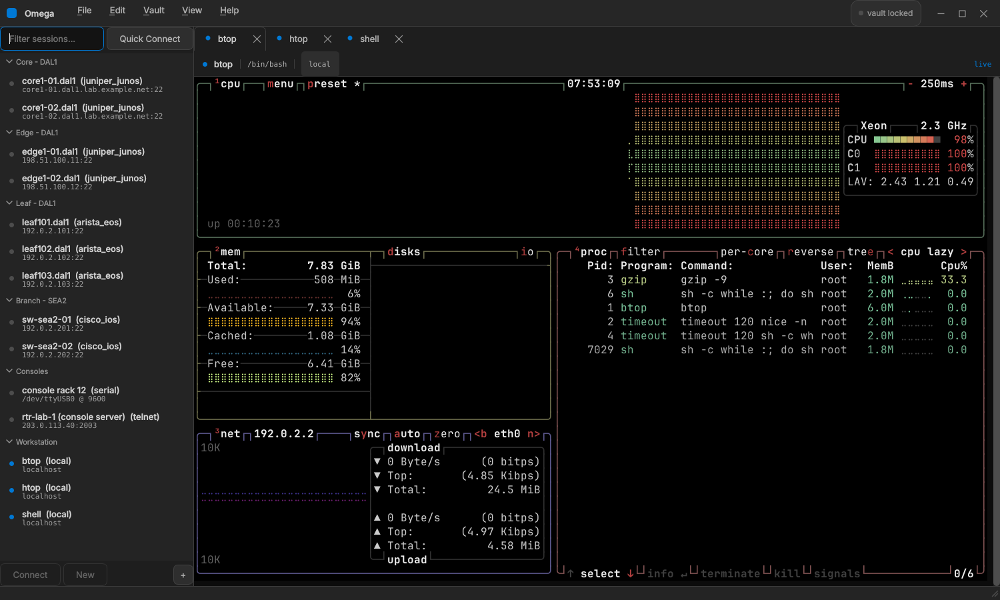
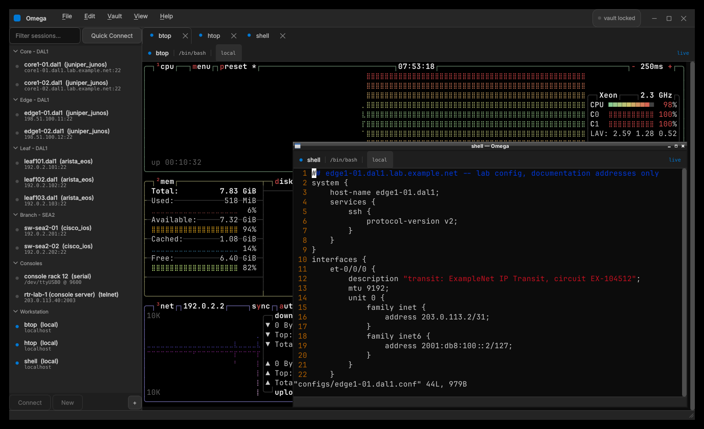
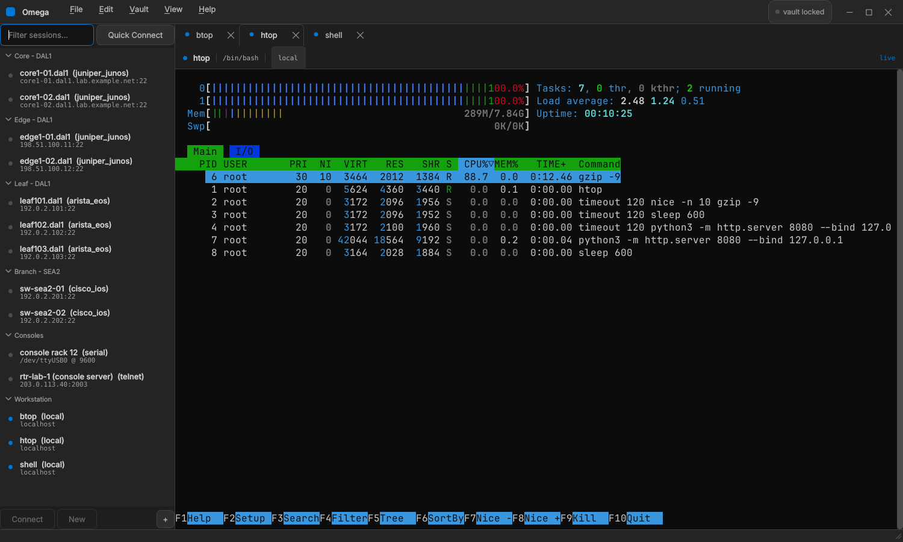
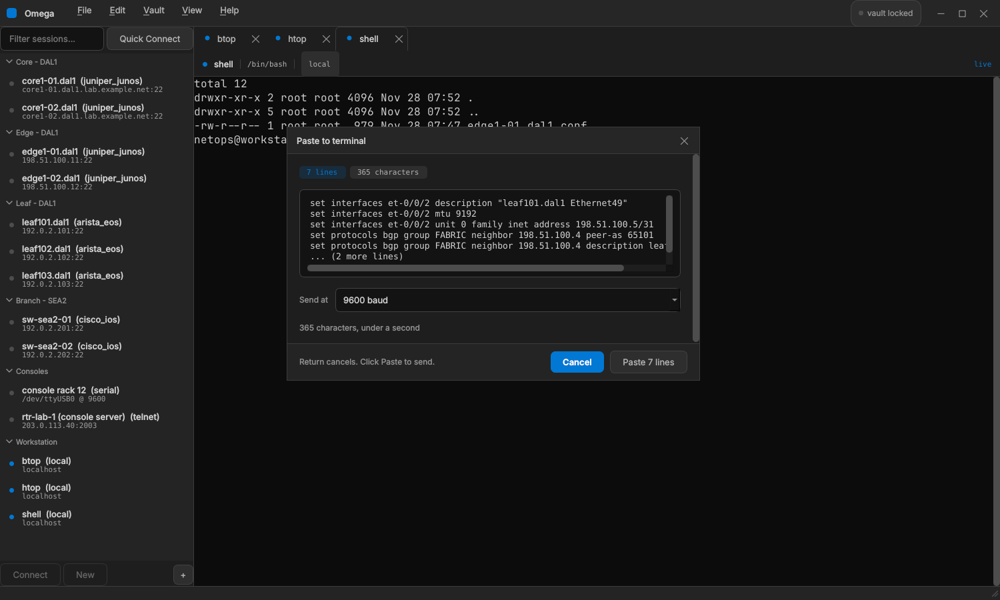
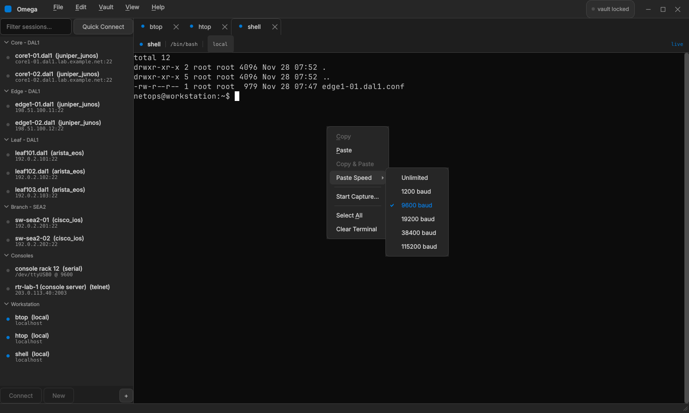
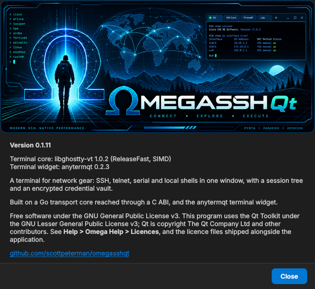

# Omega

A native terminal for network engineers, and for everything else on the desk:
SSH, telnet, serial and local shells in one window, with a session tree, an
encrypted credential vault, and libghostty-vt underneath. Linux, Windows and
macOS, from one codebase, with no Python and no Electron in the process.



## Download

Each [release](https://github.com/scottpeterman/omegasshqt/releases) carries
three packages, built by CI from the tagged source, plus `SHA256SUMS.txt`:

| | |
|---|---|
| Linux (x86-64) | `Omega-<version>-x86_64.AppImage` |
| Windows (x64) | `Omega-<version>-windows-x64.zip` |
| macOS (Apple Silicon) | `Omega-<version>-arm64.dmg` |

**None of these are signed with a certificate anybody's operating system
trusts.** They are ad-hoc signed on macOS and unsigned on Windows, because a
Developer ID and a code signing certificate are annual costs this project has
not taken on. Each platform objects in its own way, and macOS objects in a way
that sounds like the download is broken when it is not.

**macOS.** Open the dmg, drag `Omega.app` to `/Applications`, then clear the
quarantine attribute the browser attached:

```bash
xattr -dr com.apple.quarantine /Applications/Omega.app
```

Without that you get *"Omega is damaged and can't be opened"*, which is
Gatekeeper's wording for an ad-hoc signature on a quarantined file rather than
a statement about the download. Right-click → Open does not reliably clear it
on current macOS.

**Windows.** Right-click the zip → Properties → **Unblock** before extracting,
or every DLL inside inherits the mark-of-the-web and the application fails to
start. Then run `omega.exe`; SmartScreen will warn about an unknown publisher,
and *More info → Run anyway* gets past it. The MSVC runtime DLLs are in the
folder, so nothing else needs installing.

**Linux.** `chmod +x Omega-<version>-x86_64.AppImage` and run it. If your
distribution has no FUSE, add `--appimage-extract-and-run`.

Or build from source, which avoids all of the above; see
[Building](#building).

## What it does

### Sessions

- **SSH, telnet, serial and local shells.** A local shell is the login shell
  on macOS and Linux, and on Windows any of PowerShell 7, Windows PowerShell,
  cmd, WSL or Git Bash that is installed.
- **A session tree** with folders, drag to reorder and reparent, a filter, and
  a live dot on every session that is open somewhere.
- **Tabs or dedicated windows.** Double-click or *Connect* opens a session in a
  tab; *Connect in Window* (or **New** under the tree) gives it a window of its
  own, with no tab strip.
- **Per-session overrides** for term type, scrollback, font size, theme, paste
  threshold and rate, host key policy, legacy algorithms, anti-idle and a jump
  host. Anything a session does not set is inherited from the global settings
  and keeps following them; see
  [docs/SESSION-ATTRIBUTES.md](docs/SESSION-ATTRIBUTES.md).
- **Quick connect** for anything not worth saving, with the serial form filled
  in from the ports the machine actually has.
- **Import and export** of TerminalTelemetry `sessions.yaml` (Ctrl+I / Ctrl+E).
- **Reconnect in place.** A tab whose session ended re-dials in the same tab,
  so the scrollback above it survives.



### SSH for network gear

- Auth chain: agent → public key → password → keyboard-interactive, with a
  prompt for whatever the far end asks.
- Jump hosts, with the **same** algorithm policy on both hops.
- Host-key policy as an explicit choice, strict, TOFU or insecure, with a
  prompt on first contact.
- A legacy algorithm tail for gear that only speaks `group1-sha1` and CBC.
- Telnet is never a fallback from a failed SSH connection. That would silently
  downgrade a session the operator believed was encrypted.

### The terminal

- **libghostty-vt** is the emulation core in release builds: the VT engine
  behind the Ghostty terminal, so full-screen programs (htop, btop, vim, mc,
  tmux) render the way they do in any mainstream terminal. Help → About names
  the core and its build.
- **Full mouse support.** Programs that ask for the mouse get clicks, drags,
  hover and the wheel. **Shift keeps the mouse for you** while they have it:
  Shift-drag selects, Shift-wheel scrolls back, Shift-right-click opens the
  menu. The pointer is an arrow while a program is reading the mouse and an
  I-beam otherwise.
- **Copy and paste** on Ctrl+Shift+C / Ctrl+Shift+V, so Ctrl+C stays an
  interrupt. Copy with nothing selected does nothing rather than sending one.
- **Zoom** per tab with Ctrl+= / Ctrl+- or Ctrl+wheel; Ctrl+0 resets.
- Session capture to a log, anti-idle, and 33 themes switching live, per
  window or pinned per session.



### Paste, at the speed of the far end

Paste is the one place a terminal can lose characters silently. Forty lines
into a console port with no flow control arrive short, and nothing says so.



The confirmation appears above a configurable line threshold (default 1,
which is deliberate for network gear) and it is where the rate gets chosen,
because that is where the block is on screen and the estimate can say what
the choice costs. Baud rather than a millisecond delay: baud is the number
already known about the far end, printed on the device rather than guessed at.
Serial defaults to the port's own baud, telnet to 9600, SSH is unpaced. Escape
cancels a paste in flight. The context menu, Ctrl+Shift+V and Copy & Paste all
go through it.



The Paste Speed submenu covers pastes too short to raise a confirmation.

### Credentials

A vault unlock dialog and a credential manager that adds, edits, renames,
disables and sets a default. Sessions reference a credential by **name**; the
material is read on the Go side during the dial and never crosses back into
the UI. The vault can unlock itself from the OS keyring.



## Keys and mouse

| | |
|---|---|
| Ctrl+Shift+C / Ctrl+Shift+V | Copy / paste (in the terminal) |
| Ctrl+= / Ctrl+- / Ctrl+0 | Zoom in / out / reset (Ctrl+wheel too) |
| Shift + drag, wheel, right-click | Select, scroll back, menu, while a program has the mouse |
| Escape | Cancel a paste in flight |
| Ctrl+N | Quick connect |
| Ctrl+W / Ctrl+Shift+W | Close tab (or a session window) / close all tabs |
| Ctrl+I / Ctrl+E | Import / export sessions |
| Ctrl+, | Settings |
| Ctrl+Shift+C | Credential manager (outside the terminal) |
| Ctrl+Shift+Home / End | Fit / centre the window on its screen |
| F1 | Help |

On macOS, Ctrl in this table is ⌘.

## Files

Everything Omega keeps is under `~/.omega`:

| | |
|---|---|
| `config.json` | Window, theme and terminal settings |
| `omega.json` | Omega's own settings: title bar, anti-idle, default auth |
| `sessions.db` | The session tree (SQLite) |
| `vault.json` | The credential vault, encrypted |
| `themes/` | Theme files, seeded from the package on first run and yours to edit |
| `logs/` | Session captures |

Help → Omega Help → Files on Disk says the same from inside the application.

---

## Under the hood

Go underneath, a C ABI in the middle, Qt on top.
[anytermqt](https://github.com/scottpeterman/anytermqt) is the terminal
widget; omegassh, the library in this repository, turns a network device into
a byte stream. Neither knows about the other until `omegassh::attach` joins
them, so each is small enough to finish:

```cpp
omegassh::Config cfg;
cfg.host = "eng-leaf-1.lab.local";
cfg.username = "labadmin";
cfg.privateKeyPath = "~/.ssh/id_ed25519";
cfg.hostKeyPolicy = omegassh::HostKeyPolicy::Tofu;
cfg.legacyAlgorithms = true;          // for gear that predates the good ciphers

auto *terminal = new qtpyte::TerminalWidget(this);
auto *session  = new omegassh::OmegaSshSession(this);

omegassh::attach(terminal, session);   // the same three connections
                                       // qtpyte::attach makes

// start() does not wait for the far end. It returns as soon as the config
// has been checked, and the connect reports itself here.
connect(session, &omegassh::OmegaSshSession::stateChanged,
        this, &MyTab::showOverlay);    // connecting, authenticating, connected
connect(session, &omegassh::OmegaSshSession::errorOccurred,
        this, &MyTab::showError);      // ...or why it did not get there

session->start(cfg);
```

`OmegaSshSession` carries the same signal names as anytermqt's `PtySession`
(`dataReceived`, `write`, `resize`, `terminate`, `finished(int)`), so the
widget cannot tell whether it is driving a local shell or a router two
continents away. The dial runs behind `start()` rather than inside it, so it
is safe on the GUI thread: a connection overlay cannot paint on a thread that
is blocked dialing.

One transport interface underneath SSH, telnet and serial: `read`, `write`,
`resize`, `alive` and `close` mean the same thing whichever is open. The same
goes for how a session reports itself, one state vocabulary and one event
queue, except that no transport fakes a state it cannot reach. Telnet never
reports authenticating, because the protocol has no authentication step;
serial reports neither connecting nor authenticating, because opening the port
is the whole handshake.

Credential storage lives in the library despite its narrow scope, for a
mechanical reason: two Go c-archives cannot link into one process.
`include/omegassh/vault.h` opens by explaining itself.

## Layout

```
app/          Omega itself: the window, tabs, session tree, dialogs
sshcore/      the SSH work, plain Go, importable on its own
telnetx/      the telnet transport
serialx/      the serial transport
transport/    the contract all three satisfy: states, events, logging tap
vault/        credential storage; see include/omegassh/vault.h for why
capi/         cgo shim, marshalling only
sessions/     the session store, C++ and SQLite
theme/        the theme system and the 33 theme files
include/      the hand-written stable C headers
qt/           OmegaSshSession, a QObject wrapper, QtCore only
integration/  omegassh::attach and the theme→widget joint, header-only
examples/     C harnesses and three Qt examples
tests/        throwaway sshd, fake telnet and serial servers, compat suites
scripts/      build, bundle and libghostty-vt build scripts
docs/         BUILDING.md, VERIFIED.md, WINDOWS.md, design and phase notes
```

## Building

```bash
./scripts/build.sh                          # or scripts\build.bat on Windows
./scripts/build.sh --anytermqt ../anytermqt # + the app and the Qt examples
```

Needs Go 1.21+, CMake 3.19+, and Qt 6.2+ (Core only for the library; `--no-qt`
skips it). **The application additionally needs an anytermqt checkout**; without
one, `omega`, `terminal_window` and `theme_gallery` are skipped and everything
else still builds.

A source build uses anytermqt's pyte core unless told otherwise. Release builds
use libghostty-vt, which `scripts/build-ghostty-vt.sh` (or `.bat`) builds into
a prefix with the pinned Zig, and the bundle scripts take with `--ghostty`:

```bash
./scripts/build-ghostty-vt.sh --prefix ~/ghostty-vt
./scripts/bundle-appimage.sh --anytermqt ../anytermqt --ghostty ~/ghostty-vt
```

To package rather than build:

```bash
./scripts/bundle-linux.sh    --anytermqt ../anytermqt   # relocatable tarball
./scripts/bundle-appimage.sh --anytermqt ../anytermqt   # single-file AppImage
./scripts/bundle-mac.sh      --anytermqt ../anytermqt   # Omega.app, --dmg for a dmg
scripts\bundle-windows.bat                              # folder, --zip for a zip
```

`.github/workflows/release.yml` runs the same scripts on all three platforms
for every `v*` tag, smoke-tests each package, and publishes the release.
Per-platform detail (the mingw/MSVC split on Windows, the macOS bundle
ordering, what each packaging script verifies) is in
[docs/BUILDING.md](docs/BUILDING.md).

## Trying it without lab gear

`tests/labsshd.sh` stands up a throwaway sshd on `127.0.0.1:2222`:

```bash
sudo ./tests/labsshd.sh start     # prints the commands to run
./build/examples/qt/qt_smoke 127.0.0.1 2222 labuser tests/.lab/clientkey
sudo ./tests/labsshd.sh clean
```

`tests/faketelnetd.py` does the same for telnet, with no root:

```bash
python3 tests/faketelnetd.py &                        # 127.0.0.1:2323
./build/examples/c/transport_probe 127.0.0.1 2323
```

And `tests/fakeconsole.py` for serial, over a socat pty pair. A pty proves the
transport, not that a driver enumerates, so point this at a real adapter when
you have one:

```bash
socat -d -d pty,raw,echo=0,link=/tmp/omega-console pty,raw,echo=0,link=/tmp/omega-device &
python3 tests/fakeconsole.py /tmp/omega-device &
./build/examples/c/transport_probe --serial /tmp/omega-console 9600
```

The same three transports drive a real terminal widget in one example binary:

```bash
./build/examples/qt/terminal_window ssh    127.0.0.1 2222 labuser tests/.lab/clientkey
./build/examples/qt/terminal_window telnet 127.0.0.1 2323
./build/examples/qt/terminal_window serial /dev/ttyUSB0 9600
```

And the application, optionally against settings that are not your real ones:

```bash
./build/app/omega
./build/app/omega --config /tmp/config.json --omega-config /tmp/omega.json
./build/app/omega --list-themes
```

## Status

Version 0.1.11. Built and released by CI for Linux, Windows and macOS, and used
daily on all three: SSH to routers and switches, serial consoles, and local
shells in place of the platform terminal.

The theme system, settings layer, session store and TerminalTelemetry importer
began as ports of nterm-qt's and were verified against it by differential
suites rather than by inspection; Omega has since moved to its own `~/.omega`
and no longer shares files with nterm-qt. Headless probes cover what reading
the code cannot (focus, capture, paste pacing, host-key classification,
anti-idle, scrollback, multi-tab close and reconnect), and a Claude sandbox can
build and drive the application against the real libghostty-vt; see
[docs/README_Claude_Qt_sandbox.md](docs/README_Claude_Qt_sandbox.md).

The legacy algorithm tail has not been tested against hardware that needs it.
Nothing is notarized or signed beyond ad-hoc.

**[docs/VERIFIED.md](docs/VERIFIED.md) is the record of what has been
exercised**, per platform, with the caveats.

## License

GPLv3. Qt is used under the LGPLv3; libghostty-vt and the other components are
listed with their licences in [THIRD-PARTY-NOTICES.md](THIRD-PARTY-NOTICES.md)
and in Help → Omega Help → Licences.
